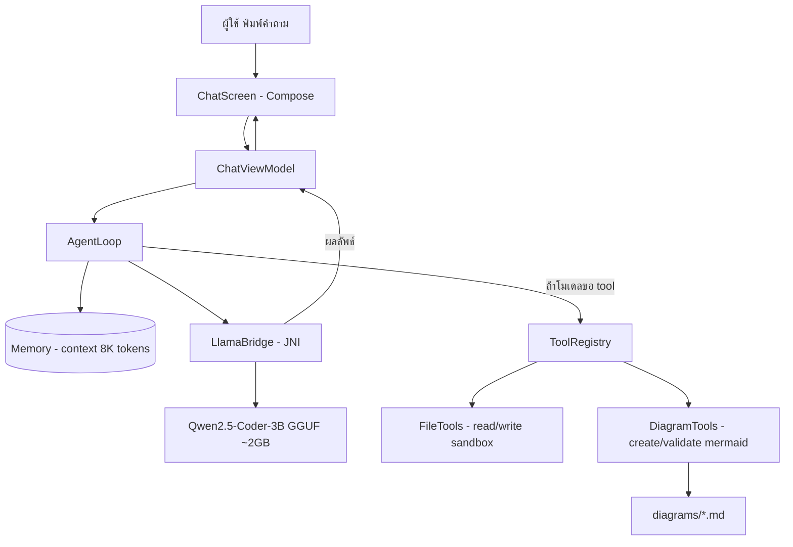

# สถาปัตยกรรมระบบ

## หลักการออกแบบ
1. **Offline ทั้งหมด** — ไม่มี network call ใน agent path
2. **Provider-agnostic** — เปลี่ยนโมเดลภายหลังได้โดยแก้แค่ LlamaBridge
3. **Sandbox file access** — agent เข้าถึงได้เฉพาะโฟลเดอร์ของแอป
4. **Validation loop** — DiagramTools ตรวจ syntax พื้นฐานก่อน save เสมอ
